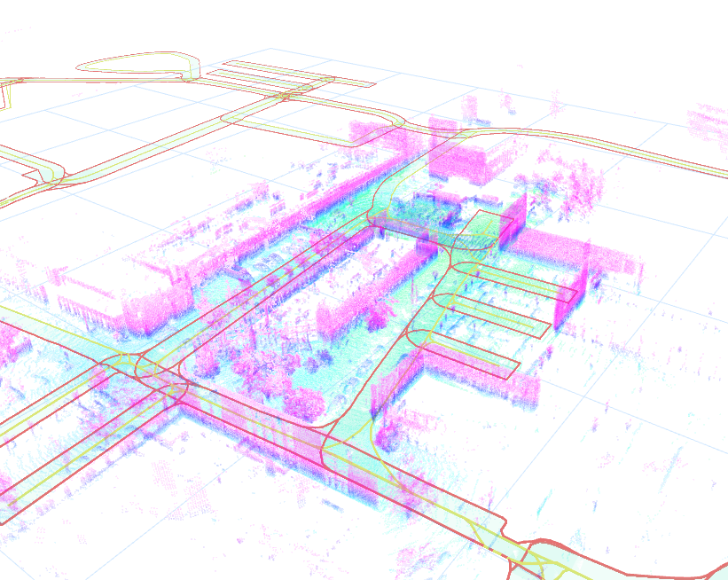

# `lanelet2_rviz2` ROS2 package

**lanelet2_rviz2** is a ROS 2 node that draws a Lanelet2 (`.osm`) map in RViz2 as a road map: asphalt, lane markings, zebra crossings, turn arrows and stop lines.

[](https://docs.ros.org/en/humble/)
[](https://docs.ros.org/en/jazzy/)

## Features
- **Lane boundaries** are solid, or **dashed where a lane change is allowed** (`subtype=dashed` or `lane_change=yes`). Each boundary is drawn once, even if two lanelets share it or carry their own copy, and the dash pattern is fitted to the line so neighbouring lines stay in step.
- **Crosswalks** are drawn as zebra stripes, clipped to the road surface.
- **Turn arrows** are painted on the lane in front of lanelets tagged with `turn_direction`.
- **Junctions** are kept quiet: only the outer road edge is drawn, and the possible paths through the junction are shown as faint guide lines.
- Stop lines, stop signs, parking lots and parking spaces, subtle driving-direction chevrons.
- **Speed limits** as an optional surface tint (green → blue → red), off by default in the supplied RViz config.
- The map is rendered **once** into ten large markers (one per layer) and published latched; changing a parameter at runtime redraws it.

Every layer is its own marker namespace, so it can be switched on and off under *Namespaces* in the RViz `MarkerArray` display:

| Namespace | Content |
|---|---|
| `road` | drivable surface |
| `speed_limit` | surface tint by speed limit |
| `lane_lines` | lane boundaries, solid and dashed |
| `junction_paths` | faint paths through junctions |
| `direction` | driving-direction chevrons |
| `turn_arrows` | pavement arrows before turns |
| `crosswalk` | zebra stripes |
| `stop_lines` | stop lines |
| `traffic_signs` | stop signs and other signs |
| `parking` | parking lots and spaces |



## Topics

### Published
- `/lanelet_markers` (`visualization_msgs/msg/MarkerArray`, reliable, transient local): the whole map.

## Parameters
All of them can be changed at runtime.

| Parameter | Type | Default | Meaning |
|---|---|---|---|
| `osm_file_path` | string | `""` | Path to the `.osm` file. Nodes need `local_x` / `local_y` tags. |
| `frame_id` | string | `map` | Frame the map is drawn in. |
| `refresh_freq` | int | `1` | Republish rate in Hz for displays that subscribe with volatile durability. `0` publishes once (latched). |
| `speed_color_max` | double | `90.0` | Speed limit that maps to the "fast" end of the tint. |
| `line_width` | double | `0.15` | Lane boundary width in metres. |
| `dash_length` / `dash_gap` | double | `1.5` / `1.5` | Dash pattern of crossable boundaries in metres. |
| `use_elevation` | bool | `false` | `false` draws the map flat at z = 0, which keeps the layers cleanly stacked. `true` uses the mapped heights; where map elements disagree in height, the road can cover markings. |

## Usage

### 1. Build the Project
Make sure your ROS 2 workspace is set up. 

Install the necessary dependencies:

```bash
sudo apt install ros-$ROS_DISTRO-lanelet2
```

Clone this repository into the `src` directory and build it:

```bash
cd ~/ros2_ws/src && git clone https://github.com/jkk-research/lanelet2_rviz2
```

```bash
cd ~/ros2_ws && colcon build --packages-select lanelet2_rviz2 --symlink-install
```

```bash
source ~/ros2_ws/install/setup.bash
```

### 2. Run the Node
The launch file starts the visualizer and RViz2 with a matching configuration ([etc/zalazone.rviz](etc/zalazone.rviz)). By default it opens the ZalaZone Smart City example map:

```bash
ros2 launch lanelet2_rviz2 visualize_osm.launch.py
```

Another map, or without RViz2:

```bash
ros2 launch lanelet2_rviz2 visualize_osm.launch.py osm_file_path:=/mnt/c/map/lanelet.osm frame_id:=map rviz:=false
```

Only the node:

```bash
ros2 run lanelet2_rviz2 lanelet2_rviz2 --ros-args -p osm_file_path:=/mnt/c/map/lanelet.osm -p frame_id:=map
```

### 3. Visualize in RViz2
With your own RViz2 configuration: add a `MarkerArray` display on `/lanelet_markers` and set the *Fixed Frame* to the `frame_id` of the node. A dark background (for example `27; 30; 36`) suits the colours. Setting the display's *Durability Policy* to *Transient Local* lets you run the node with `refresh_freq:=0`.

### 4. Dynamic Parameter Updates

```bash
ros2 param set /lanelet_visualizer line_width 0.25
ros2 param set /lanelet_visualizer osm_file_path /mnt/c/map/other.osm
```

Or with `rqt_reconfigure`:

```bash
ros2 run rqt_reconfigure rqt_reconfigure
```

## Usage with Pointcloud

### Option 1. - `pcl_ros`

```bash
sudo apt install ros-$ROS_DISTRO-pcl-ros
```

```bash
ros2 run pcl_ros pcd_to_pointcloud --ros-args -p file_name:=/home/he/dlio_map2.pcd -p tf_frame:=map_gyor_0 -p publishing_period_ms:=500 --qos-reliability best_effort
```

### Option 2. - `pcd_publisher`

[github.com/jkk-research/pcd_publisher](https://github.com/jkk-research/pcd_publisher)

```bash
ros2 run pcd_publisher pcd_publisher --ros-args -p pcd_file_path:=/home/dev/autoware_map/gyor_campus/pointcloud_map.pcd -p topic_name:=/points_campus -p frame_id:=map_gyor_0
```

## Troubleshooting
The software was designed to work in our workflow, which mainly relies on maps authored or edited with the [Vector Map Builder of TIER4](https://tools.tier4.jp/). It will likely work with Lanelet2 maps authored or written by different software, but if you run into unsupported map errors, try loading and exporting your map in the TIER4 map editor. 

## Acknowledgments
- **[Lanelet2](https://github.com/fzi-forschungszentrum-informatik/Lanelet2)** is used for parsing the OSM files.
- **[Earcut](https://github.com/mapbox/earcut.hpp)** is used for polygon triangulation, enabling visualization of filled areas in RViz2.
